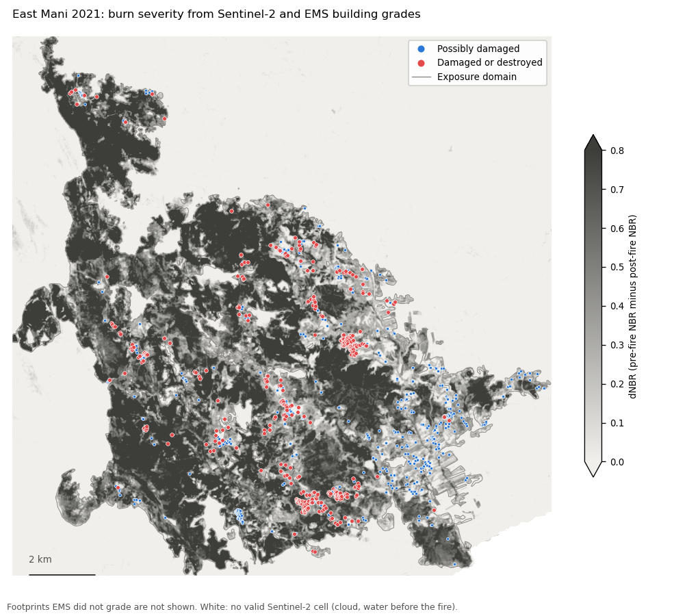
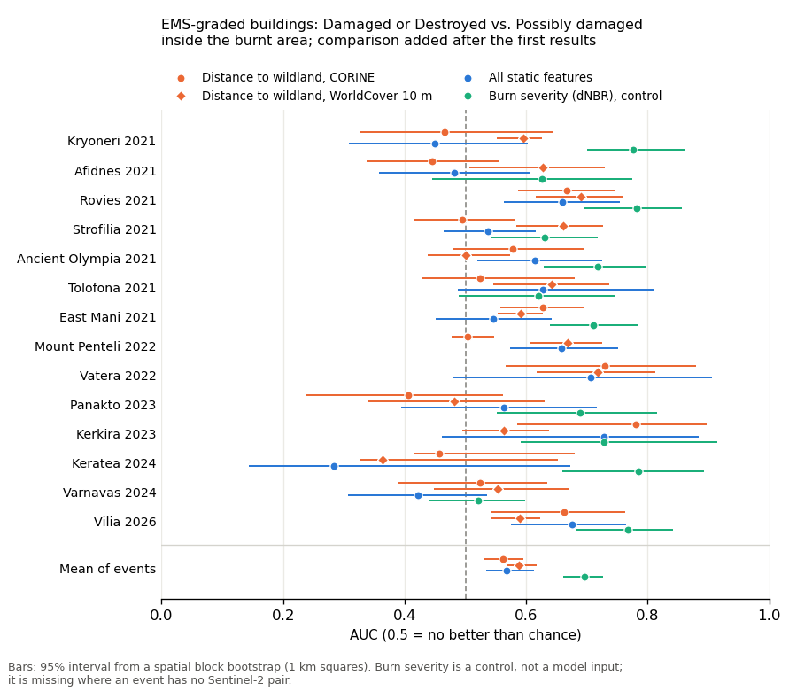

# Static site factors and building damage in Greek wildfires

When a wildfire reaches a settlement, some houses burn and their neighbours survive. Wildfire susceptibility maps are mostly built from static site factors: how close a building is to forest or shrubland, the slope it stands on, which way the slope faces, how many buildings surround it. This project asks:

**Among the buildings a fire reached, do static site factors rank the damaged ones above the undamaged ones, and how much do they add to distance to wildland alone?**

Answer, from Copernicus EMS damage grades of single buildings in recent Greek fires: weakly, and only through distance to wildland. Among the buildings EMS graded inside the burnt area, the damaged ones lie slightly nearer to wildland than those EMS graded possibly damaged, whether wildland is mapped in 25 ha patches or 10 m cells; a model on all static factors, trained on other fires, ranks them no better. Burn severity measured from Sentinel-2 after the fire ranks the same buildings clearly better, so the labels carry a signal this evaluation can detect. Against footprints EMS did not grade, distance shows no association, but that comparison partly measures which buildings EMS lists.



## Results



<!-- results:begin -->
Mean AUC over the events, with 95% intervals. All rows cover the same 14 events. In every row the damaged buildings are those EMS graded *Damaged* or *Destroyed*; the rows differ in which buildings count as undamaged. The 2 buildings EMS graded *No visible damage* count as undamaged in every row. The distance from WorldCover was added after the first results. In brackets after the difference, the number of events whose interval of the difference lies wholly above or below zero. Burn severity is the control, not a model input; Mount Penteli 2022 and Vatera 2022 have no Sentinel-2 pair and are left out of its mean.

| Counted as undamaged | Buildings (damaged) | Distance, CORINE | Distance, WorldCover 10 m | All static features | Static minus CORINE distance (events > 0 / < 0) | Burn severity (control) |
|---|---:|---:|---:|---:|---:|---:|
| *Possibly damaged* (EMS-graded buildings only; added after the first results) | 10,234 (1,394) | 0.56 [0.53, 0.59] | 0.59 [0.57, 0.62] | 0.57 [0.53, 0.61] | +0.01 [-0.02, +0.04] (3 / 1) | 0.70 [0.66, 0.73] |
| Footprints EMS did not grade | 20,242 (1,394) | 0.51 [0.48, 0.54] | 0.51 [0.49, 0.54] | 0.50 [0.46, 0.54] | -0.01 [-0.07, +0.03] (1 / 1) | 0.65 [0.62, 0.68] |
| Footprints EMS did not grade, and *Possibly damaged* | 29,080 (1,394) | 0.52 [0.49, 0.56] | 0.52 [0.51, 0.55] | 0.49 [0.46, 0.53] | -0.03 [-0.07, +0.01] (1 / 2) | 0.66 [0.63, 0.69] |
| Footprints EMS did not grade, none below 36 m² (check added after the first run) | 9,062 (1,231) | 0.54 [0.50, 0.57] | 0.54 [0.52, 0.57] | 0.52 [0.48, 0.55] | -0.02 [-0.06, +0.01] (0 / 1) | 0.68 [0.64, 0.71] |

| Score | Events above / below 0.5, undamaged = *Possibly damaged* | Events above / below 0.5, undamaged = not graded | Spread between events beyond sampling error, headline: I² (p) |
|---|---:|---:|---:|
| Distance to wildland, CORINE | 5 / 0 of 14 | 2 / 1 of 14 | 73% (< 0.001) |
| Distance to wildland, WorldCover 10 m | 9 / 0 of 14 | 2 / 1 of 14 | 70% (< 0.001) |
| All static features | 4 / 0 of 14 | 0 / 0 of 14 | 60% (0.002) |
| Burn severity (dNBR), control | 9 / 0 of 12 | 10 / 0 of 12 | 69% (< 0.001) |

The first two columns count the events whose interval lies wholly above or below 0.5, of the events with that score. I² is the share of the spread of the per-event AUCs that their bootstrap errors do not explain (Cochran's Q). The labels of two buildings less than 100 m apart correlate at 0.30, at 0.03 for buildings 500-600 m apart and at 0.02 for 1000-1100 m (headline labels, `label_correlation.csv`).

Model slopes in the headline comparison, in log-odds per standard deviation of the feature (`n_neighbours` as log(1 + n)); a negative slope for `wildland_dist_m` means nearer to wildland, more damage.

| Feature | Slope, all events | Range over the held-out fits |
|---|---:|---:|
| `wildland_dist_m` | -0.06 | -0.12 to -0.03 |
| `wildland_frac` | +0.11 | -0.03 to +0.23 |
| `slope_deg` | +0.10 | +0.04 to +0.14 |
| `northness` | +0.03 | -0.01 to +0.04 |
| `eastness` | -0.12 | -0.14 to -0.09 |
| `tpi_m` | +0.08 | +0.05 to +0.12 |
| `n_neighbours` | -0.23 | -0.32 to -0.07 |

At 10 m, 64% of all 29,080 buildings stand on a WorldCover tree, shrub or grass cell and 92% lie within 20 m of one, so the finer distance mostly separates buildings on such a cell from those next to one.

Footprint area alone, which is not one of the features, gives a mean AUC of 0.80 for EMS-graded vs. ungraded footprints but 0.43 for damaged vs. possibly damaged ones. Of the footprints at least as large as the median EMS-graded one (118 m²), the share EMS did not grade ranges by event from 5% (Vilia 2026) to 40% (Kryoneri 2021).
<!-- results:end -->

The AUC is the probability that a randomly chosen damaged building of a fire scores higher than a randomly chosen undamaged one (0.5 = chance). Per-event numbers are in [`outputs/results/auc_by_event.csv`](outputs/results/auc_by_event.csv).

- **Which buildings count as undamaged is the main design choice.** The headline compares buildings EMS graded *Damaged* or *Destroyed* with those it graded *Possibly damaged*, all inside the burnt area. The footprints EMS did not grade make a poor undamaged group: footprint area alone separates them from the EMS-graded ones, they include large buildings as well as sheds and detection errors, and EMS does not document whether it left them out as unaffected or missed them. A comparison with them partly measures which buildings EMS lists. It remains as a secondary row; the small structures in it pull the AUC towards 0.5, the direction of the rest is unknown.
- **Bias of the headline comparison.** *Possibly damaged* covers damage EMS could not confirm on the imagery, and the legend of one product (EMSR909) describes it as "presence of damage proxies and proximity with destroyed/damaged asset". Both put damaged buildings and close neighbours of damaged buildings into the undamaged group and pull the AUC towards 0.5. Whether damage could be confirmed may itself depend on the setting, such as smoke or tree cover over roofs, which can bias the AUC either way. Both classes come from the same EMS list, and in most events a similar share of each has its geometry from OpenStreetMap (`osm_share_*` in [`label_summary.csv`](outputs/labels/label_summary.csv)).
- **The labels carry a signal the evaluation can detect.** Burn severity around the building, from Sentinel-2 images before and after the fire, ranks damaged buildings above the others in most fires and in every comparison. It is measured after the fire, so it is a control, not a predictor: it shows that the labels and the per-event evaluation can separate damaged buildings when a variable is related to damage, so the weak result for the static factors is not explained by noise in the labels alone. The control is missing for the two 2022 fires, for which the Sentinel-2 catalogue used has no acquisition in the post-fire window ([`scenes.csv`](outputs/sentinel2/scenes.csv)); the selection rules were not relaxed and no other source was substituted.
- **The other factors add nothing.** Whichever buildings count as undamaged, the model on all seven features does not improve on distance alone on average, and in the few single fires where the difference is clear it goes either way. Its slopes are all small and mostly keep their sign across the held-out fits; the largest says that buildings with fewer neighbours were more often damaged.
- **Finer land cover strengthens the distance signal slightly.** Distance to wildland from 10 m WorldCover cells, added after the first results to test whether CORINE's 25 ha patches hide the effect, has a slightly higher mean AUC than the CORINE distance and lies above chance in more single fires, but stays well below burn severity. At 10 m most buildings stand on or next to a vegetation cell, so the measure mostly tells whether vegetation reaches the building at all.
- **Fires differ in strength, not in direction.** In the headline comparison the per-fire AUCs of every score spread more than their sampling errors explain. Most single-fire intervals for the CORINE distance include 0.5, but no single-fire interval of any score lies wholly below it. The mean intervals only reflect sampling within the study fires, not this spread or the variation between training sets, so they are narrower than the uncertainty for a new fire.
- **Scope.** Every building here stood inside the burnt perimeter. The result says nothing about which areas a fire reaches, the question susceptibility maps are built for; it is about which buildings are lost once a fire is there.

## Data and labels

| Role | Dataset |
|---|---|
| Damage labels and burnt area | Copernicus EMS rapid-mapping grading products, Greek wildfire activations since 2019 |
| Buildings | Microsoft Global ML Building Footprints, Greece (2026 release) |
| Terrain | Copernicus GLO-30 DEM |
| Land cover | CORINE Land Cover 2018; ESA WorldCover 2020 (10 m) for one check |
| Burn severity (control) | Sentinel-2 L2A Collection 1, Cloud-Optimized GeoTIFFs on AWS, found through the Earth Search STAC catalogue |

EMS analysts grade single buildings on post-fire satellite imagery as *Possibly damaged*, *Damaged* or *Destroyed*; a few products also grade buildings away from the fire as *No visible damage*. One study event is one graded area of interest (AOI). Its exposure domain, which holds the buildings analysed, is the AOI intersected with the burnt-area polygons of the same activation.

- **Label.** Each EMS point is linked to the footprint containing it, or to the nearest footprint within 10 m. *Damaged* and *Destroyed* count as damaged. The undamaged group is the buildings EMS graded *Possibly damaged* in the headline, and the footprints EMS did not grade in the secondary rows. [`docs/data_sources.md`](docs/data_sources.md) quotes the EMS definitions and sets out what is known about which buildings EMS grades.
- **Event selection**, fixed before any modelling (`config/events.yaml`): an AOI needs at least 10 damaged points, and at least 80% of them must find a footprint, because the footprints postdate most fires and destroyed houses may be missing from them. [`ems_events.csv`](outputs/labels/ems_events.csv) gives the reason for every candidate AOI, [`label_summary.csv`](outputs/labels/label_summary.csv) the counts and link rates of the selected ones, and [`label_maps.png`](outputs/labels/label_maps.png) maps their domains and labels.

Terrain and land cover predate every fire; CORINE 2018 is the reason fires before 2019 are not used.

## Method

Features per building (`src/features/build.py`):

| Feature | Definition |
|---|---|
| `wildland_dist_m` | distance to the nearest CORINE forest, shrub or natural-grassland cell, capped at 500 m |
| `wildland_frac` | share of the 500 m disc around the building that is such land cover |
| `slope_deg`, `northness`, `eastness` | slope and aspect components at the footprint centroid |
| `tpi_m` | elevation minus the mean elevation within 300 m (ridge > 0, valley < 0) |
| `n_neighbours` | other footprints within 100 m |

Two scores are compared on every event (`src/analysis/evaluate.py`, settings in `config/analysis.yaml`):

- **Distance only**: nearer to wildland ranks higher. Nothing is fitted. The same score from ESA WorldCover 2020 tree cover, shrubland or grassland at 10 m (`wildland_dist_wc_m`, same 500 m cap) is reported next to it; it was added after the first results and is not a model input.
- **All static features**: logistic regression on all seven features, trained on the other events and applied to the held-out one. AOIs of the same EMS activation can belong to the same fire, so they are held out together. Each training event has its own intercept: damage rates differ widely between fires, and the slopes should describe differences within a fire, not which fires were worse.

A third score, burn severity, is the control (`src/features/dnbr.py`, rules in `config/features.yaml`, fixed before any value was computed). NBR = (B8A − B12) / (B8A + B12) is computed from Sentinel-2 surface reflectance at 20 m, and dNBR is NBR before minus NBR after the fire, averaged over the valid cells within 100 m of each footprint centroid. The post-fire image is the acquisition closest after the fire, 10 to 40 days after the EMS activation, at which at least 95% of the event's buildings fall on cells the scene classification layer marks as free of cloud, cirrus and missing data; the pre-fire image is the acquisition closest before the fire, 40 to 5 days before the activation, that meets the same test on the same orbit. The images are read window by window from the cloud-hosted files, not downloaded; [`scenes.csv`](outputs/sentinel2/scenes.csv) lists the acquisitions used.

Damage clusters in space, so neighbouring buildings are not independent; the 95% intervals come from a bootstrap that resamples 1 km grid squares instead of buildings. The square size was set before the labels' correlation was measured; the labels correlate mainly over short distances and weakly up to more than 1 km (results block, [`label_correlation.csv`](outputs/results/label_correlation.csv)), so the intervals are somewhat narrow.

## Limitations

- **Fuel next to the house is measured crudely.** CORINE maps units of 25 ha or more, so its distance is distance to large patches. WorldCover at 10 m sees gardens and small stands, but at that resolution distance saturates near zero, and village trees and houses share mixed cells. How much vegetation surrounds a house within a few tens of metres was not measured, and the results do not cover it.
- **Footprints postdate the fires.** Houses destroyed in 2021 may have been cleared or rebuilt by the 2026 footprint release. The link-rate rule drops the AOIs where this is visible, but surviving damaged buildings are probably over-represented among the linked ones.

## Earlier version

The first version of this repository had no observed damage. Each of four Attica fires was represented by a circle around its reported location, buildings inside a circle were labelled burned, and a weighted susceptibility index and a LightGBM model were scored against those labels. The AUCs it reported measured agreement with the circles, not with damage, and have been discarded together with the code that produced them.

The second version used the EMS grades but counted every footprint EMS had not graded as undamaged and left the possibly damaged buildings out. It found no association for distance and concluded that static factors do not rank damaged buildings. The comparison among EMS-graded buildings replaced it as the headline after those results were seen; its design was written into `config/analysis.yaml` before it was run.

## How to run

[`data/analysis_table.csv`](data/analysis_table.csv) holds every building of the study events with its label and features, so the results need no download (Python 3.11 or later):

```bash
pip install -e ".[dev]"
python -m src.analysis.evaluate   # the figure, auc_by_event.csv and the results block above
pytest tests/
```

CI runs the same commands and fails if the results block changes.

The table is built from the sources by the steps below: several gigabytes of downloads, no credentials. Each download writes a `manifest.json` with URL, SHA-256, retrieval time and licence; see [`docs/data_sources.md`](docs/data_sources.md).

```bash
python -m src.acquire.ems              # EMS activations and grading packages
python -m src.acquire.buildings        # footprints around each event
python -m src.acquire.dem
python -m src.acquire.corine
python -m src.acquire.worldcover
python -m src.preprocess.buildings
python -m src.labels.build             # labels and outputs/labels/label_summary.csv
python -m src.labels.maps              # outputs/labels/label_maps.png
python -m src.features.dnbr            # Sentinel-2 control, read over HTTP; outputs/sentinel2/
python -m src.features.build           # data/analysis_table.csv
```

## Licences

Code: MIT ([`LICENSE`](LICENSE)). `data/analysis_table.csv` contains building centroids and areas derived from the Microsoft footprints and is released under ODbL 1.0.

Source data: Copernicus EMS and CORINE: © European Union, Copernicus Emergency Management Service / Copernicus Land Monitoring Service (Regulation (EU) 2021/696). GLO-30: © DLR e.V. 2010-2014 and © Airbus Defence and Space GmbH 2014-2018, provided under COPERNICUS by the European Union and ESA. Sentinel-2: contains modified Copernicus Sentinel data 2021-2026. WorldCover: © ESA WorldCover project 2020 / Contains modified Copernicus Sentinel data (2020) processed by ESA WorldCover consortium, CC BY 4.0. Building footprints: Microsoft, ODbL 1.0.
